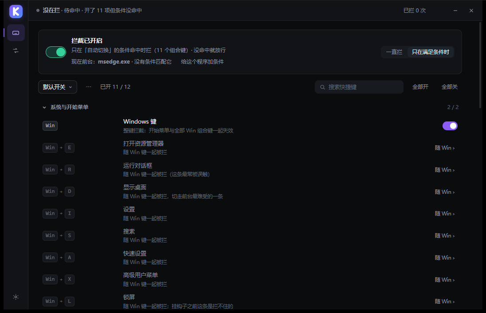
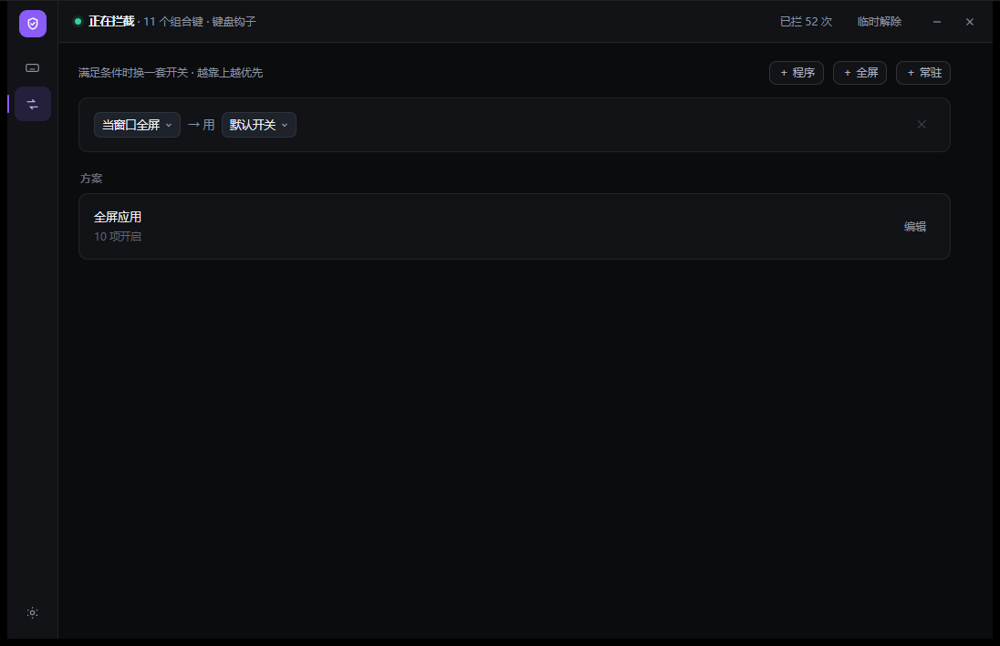
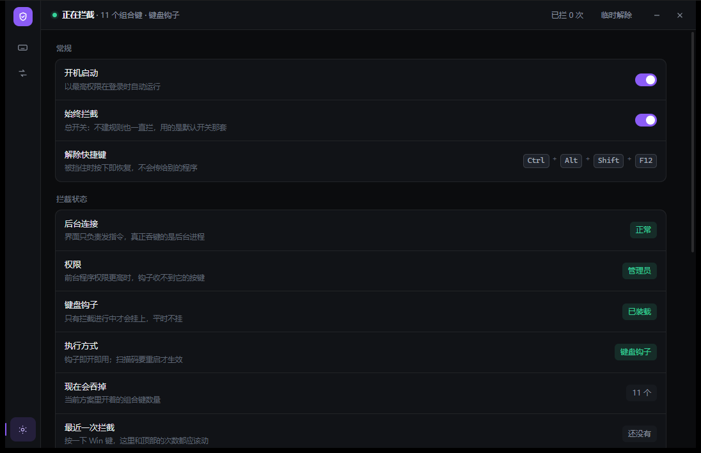
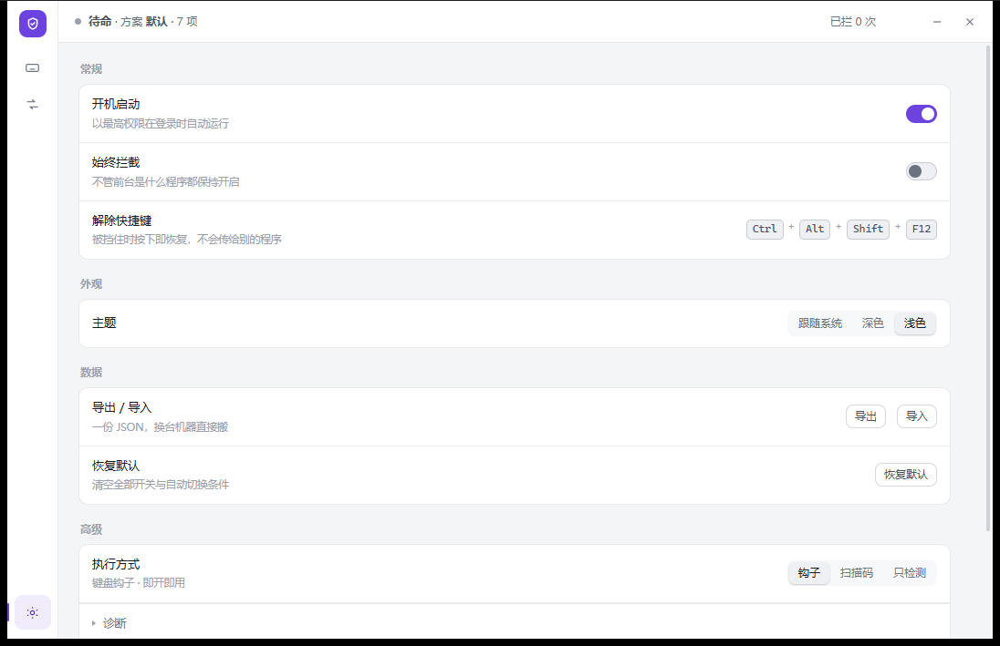

<div align="center">


# KeyGuard

**A condition-driven gate for Windows shortcuts** — no driver, no network access, no injection into other processes.

[](#installation)
[](#known-limitations)
[](LICENSE)

English | [简体中文](README.md)

</div>

Pressing <kbd>Win</kbd> mid-game opens the Start menu and pushes the game to the background; a stray <kbd>Alt</kbd>+<kbd>Tab</kbd> during screen sharing exposes the desktop; in a remote session your shortcuts get forwarded to the other side. KeyGuard does one thing: **it blocks the specified key combinations under the conditions you define, and restores them as soon as those conditions end.**

---

## Contents

- [What it does](#what-it-does)
- [Installation](#installation)
- [Quick start](#quick-start)
- [Interface](#interface)
- [Rule model](#rule-model)
- [Configuration files](#configuration-files)
- [CLI and pipe](#cli-and-pipe)
- [Building from source](#building-from-source)
- [Repository layout](#repository-layout)
- [How it works](#how-it-works)
- [Known limitations](#known-limitations)
- [FAQ](#faq)
- [License](#license)

---

## What it does

| Scenario | Configuration | Result |
| --- | --- | --- |
| Gaming | Condition "foreground process is `cs2.exe`" → profile "Game" | Win / Alt+Tab / Alt+F4 blocked only while CS2 is in the foreground; restored after switching |
| Screen recording | Condition "foreground process is `obs64.exe`" → profile "Demo" | Accidental window switching during recording does not affect the recording |
| Emulator | Condition "foreground process is `MuMuNxMain.exe`" + "fullscreen only" | Blocked in fullscreen only; shortcuts stay available in windowed mode |
| Start menu suppression only | Master switch set to "always block" + only <kbd>Win</kbd> enabled | Only the Win key is blocked in every program; other keys pass through |

Three concepts make up the whole feature set:

- **Default profile**: the globally effective set of key combinations; edits take effect immediately.
- **Profile**: an independently saved set of key combinations that conditions can reference; edits apply to the currently selected profile.
- **Condition (Rule)**: decides which profile applies and when. Three kinds — "process", "fullscreen", "always" — and the first match from top to bottom wins.

---

## Installation

Download `KeyGuard-0.1.12-setup.exe` from [Releases](../../releases) and run the installer.

| Package | Install location | Privilege |
| --- | --- | --- |
| `KeyGuard-0.1.12-setup.exe` | `C:\Program Files\KeyGuard` (changeable in the wizard) | UAC prompt required |
| `KeyGuard-0.1.12-peruser-setup.exe` | `%LOCALAPPDATA%\Programs\KeyGuard` | no UAC prompt |

Silent install:

```bat
KeyGuard-0.1.12-setup.exe /S /D=D:\Tools\KeyGuard
```

`/D` must be the last parameter, and the path must not be quoted. Uninstalling preserves the configuration under `%APPDATA%\KeyGuard\`, which stays in effect after reinstalling. Per-version changes: [docs/发布-0.1.12.md](docs/发布-0.1.12.md).

> On first launch Windows shows a SmartScreen "Unknown publisher" prompt: the installer is not code-signed, so select "Run anyway" in that dialog. Alternatively, build from source — see [Building from source](#building-from-source).

---

## Quick start

1. **Keys page (快捷键)**: the switch at the top is the master switch, set to "only when conditions match" by default. Key combinations are listed in groups below; click the switch at the end of a row to enable or disable it. Changes are written to the configuration immediately — there is no Save button.
2. **Auto-switch page (自动切换)**: click "+ Process" to pick an executable (the field offers suggestions, or click "Current foreground" to take the current process) and choose the profile to apply. Click "+ Fullscreen" when the condition should depend on fullscreen state.
3. **Combinations outside the list**: at the bottom of the Keys page click "Record combination" (录制组合键), press the target combination (up to three keys), and after saving it appears under "Custom keys".

After every change a toast "Updated" appears in the lower right corner; click "Undo" within 6 seconds to revert that change.

---

## Interface

Three pages, switched by the icons on the left. The status bar at the top always shows the current blocking state:
`Blocking · 11 combinations · keyboard hook` / `Not blocking · idle · 11 enabled but no condition matched` / `Not blocking · master switch off` / `Partial blocking · foreground process has higher privilege`.

| Keys | Auto switch | Settings |
| --- | --- | --- |
|  |  |  |

Light theme: Settings → Appearance → Light (or follow the system automatically).



---

## Rule model

The engine reduces the outcome to a boolean; conditions only decide **which set of combinations** is applied:

```
final block = master switch on AND ( "always block" selected OR a condition matches )
```

Condition precedence:

```
manually selected profile > profile named by the condition > process condition > fullscreen condition > "always" condition > default profile
```

Fields of each condition:

| Field | Meaning |
| --- | --- |
| `exe` | Process name list (array in JSON, comma-separated in the UI). Partial match and the `*` wildcard are supported: `deltaforce` matches `DeltaForceClient-Win64-Shipping.exe`; empty means unrestricted |
| `fullscreen` | Whether the window must be fullscreen |
| `always` | Resident: ignores the foreground process and always matches |
| `action` | `lock` (block) / `ignore` (pass through) / `unlock` (release); the UI always uses `lock` |
| `profile` | Profile applied on match; empty means the default profile |
| `delay_ms` / `release_delay_ms` / `ttl_ms` | Enter delay, release delay, maximum hold time |
| `enabled` | Enable state of a single condition |

---

## Configuration files

All located in `%APPDATA%\KeyGuard\`:

| File | Content |
| --- | --- |
| `rules.json` | Conditions, profiles, default profile, master switch. Format version 8 |
| `ui.json` | UI preferences (current page, light/dark theme) |

`rules.json` structure (defaults omitted):

```jsonc
{
  "version": 8,
  "hotkeys": ["win", "alt-tab", "alt-f4"],      // default profile: globally effective combinations
  "blocking": true,                              // master switch
  "always": false,                               // true = always block, conditions do not participate
  "backend": "hook",                             // hook / scancode / off
  "profiles": [
    { "id": "game", "name": "Game", "trigger": "process", "enabled": true,
      "on": ["win", "alt-tab", "alt-f4", "alt-esc"] }
  ],
  "rules": [
    { "id": "r1", "name": "Play CS2", "exe": ["cs2.exe"], "class": "",
      "fullscreen": false, "foreground": true, "always": false,
      "action": "lock", "profile": "game", "delay_ms": 0,
      "release_delay_ms": 0, "ttl_ms": 0, "enabled": true }
  ],
  "custom": [                                    // combinations recorded by the user
    { "id": "x:ctrlaltq", "name": "", "combo": "Ctrl + Alt + Q",
      "vks": [17, 18, 81], "need": 3 }
  ]
}
```

The file can be edited directly; the UI re-reads it on its next operation. Every change made in the UI is written immediately, so both sides stay consistent.

---

## CLI and pipe

`kg-agent.exe` is both a resident process and a one-shot client:

```bat
kg-agent.exe status            :: print status JSON (foreground/background, fullscreen verdict, counters)
kg-agent.exe lock              :: block immediately
kg-agent.exe unlock            :: pass through immediately
kg-agent.exe catalog-json      :: print every blockable combination (blocking method, default enable state)
kg-agent.exe --restore         :: restore modified system state (scancode map, accessibility) and exit
```

The UI and the background process communicate through a single named pipe `\\.\pipe\keyguard.v1`; every message is a single line of JSON:

```jsonc
// request
{"op":"status"}
{"op":"set_hotkeys","ids":["win","alt-tab"]}
{"op":"put_rules","rules":{ /* whole RuleSet */ }}
// response
{"ok":true,"data":{ /* ... */ }}
```

The `caps` array in the `status` response declares which capabilities the background supports (`custom_keys` / `list_procs` / `profile_meta` / `always_rule`); the UI decides from it which buttons to show, so UI and background can be upgraded independently and an older background does not break a newer UI.

---

## Building from source

Requires Rust stable (1.75+) and the MSVC toolchain; packaging additionally requires [NSIS 3.x](https://nsis.sourceforge.io/).

```bat
cargo build --release --workspace
cargo test -p kg-core          :: 51 unit tests
```

Artifacts are `target\release\kg-ui.exe` and `kg-agent.exe`; double-click `kg-ui.exe` to start — the background process is launched automatically.

Packaging (run inside `installer\`; output goes to `dist\`):

```bat
makensis keyguard.nsi                          :: all users
makensis /DKEYGUARD_PER_USER keyguard.nsi      :: current user
```

The icon comes from `assets\keyguard.ico`; `crates/*/build.rs` compiles it into the executables through `rc.exe` from the Windows SDK. When rc.exe is missing the build only warns and continues (the executables fall back to the system default icon).

---

## Repository layout

```
crates/
  kg-core/        engine: hook, condition matching, fullscreen detection, config I/O, pipe protocol
  kg-agent/       resident process: owns the hook, tray icon, scheduled-task autostart
  kg-ui/          UI: tao + WebView2 shell, page is the single file assets/index.html
assets/           icons (ico / svg / rgba)
installer/        NSIS script
dist/             installer artifacts
docs/             design notes, release notes, screenshots, icon sources
tools/            development scripts (screenshots, acceptance, packaging)
```

The UI is **a single HTML file** with no frontend framework and no build step: edit `crates/kg-ui/assets/index.html` and run `cargo build -p kg-ui` again.

---

## How it works

- Blocking relies on the `WH_KEYBOARD_LL` low-level keyboard hook, **installed only while blocking is required**; it is not resident otherwise and adds no input latency (hook callback p99 around 0–1 µs).
- "Fullscreen" is decided by three signals together: whether the window rectangle covers its monitor, whether it is cloaked by DWM, and whether `SHQueryUserNotificationState` reports a fullscreen or presentation state. Borderless fullscreen is recognized as well.
- The background process starts at logon with the highest privilege (scheduled task) so it can block games running as administrator; the UI runs with normal privileges, can only send commands through the named pipe, and never holds the hook itself.
- Fallback backend `scancode`: writes a registry mapping that maps the Win key to nothing, takes effect after a restart, handles single keys only, and serves as a fallback when an anti-cheat removes the hook.

---

## Known limitations

- **Not blockable**: <kbd>Ctrl</kbd>+<kbd>Alt</kbd>+<kbd>Del</kbd>, the UAC secure desktop, and the lock-screen logon UI — these sequences bypass user-mode hooks at the system level.
- **Privilege suppression**: when the foreground process runs with higher privilege than the background, the hook receives no keys from it and the status bar shows "Partial blocking".
- The **scancode backend** is global: switching requires a restart and it handles single keys only, so combinations such as Alt+Tab are out of its scope.
- **Verified on Windows 10/11 x64 only**; no 32-bit or ARM64 builds are provided.
- The interface is Simplified Chinese only; no localization is provided.

---

## FAQ

**Q: After installation, pressing Win still opens the Start menu.**
Check the status bar. "Idle" means no condition matched: on the Auto-switch page click "Current foreground" and verify the process name (game processes are usually `xxx-Win64-Shipping.exe`, not the launcher). "Partial blocking" means the foreground process has higher privilege than the background.

**Q: "Fullscreen only" is set, yet blocking is always active.**
Check whether "Always block" on the Settings page is enabled: while it is on, conditions no longer participate in the decision.

**Q: Does it affect normal typing?**
No. Only the combinations in the list are handled; all other keys pass through unchanged.

**Q: Is key data collected?**
No, and the program does not access the network. All logic runs locally; the configuration lives in `%APPDATA%\KeyGuard\rules.json`.

**Q: Are system changes reverted after uninstalling?**
The `scancode` backend writes a registry mapping, which both the uninstaller and `kg-agent.exe --restore` revert; the `hook` backend makes no system changes.

---

## License

MIT, see [LICENSE](LICENSE).
