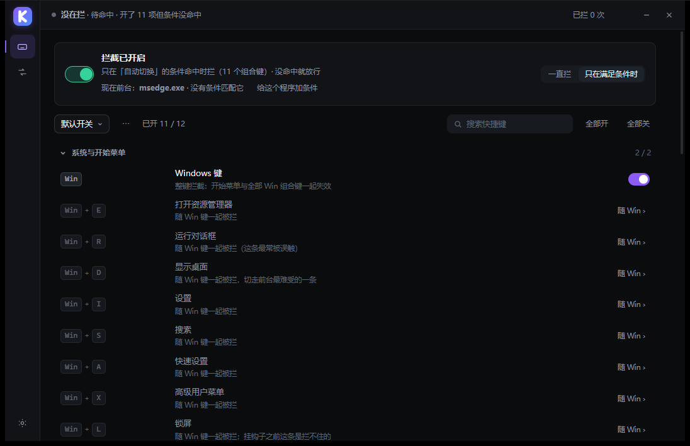
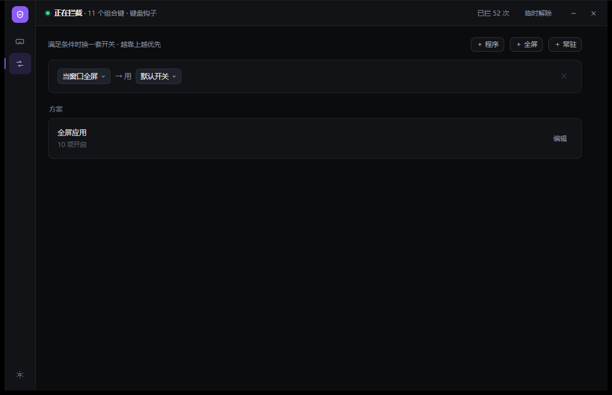
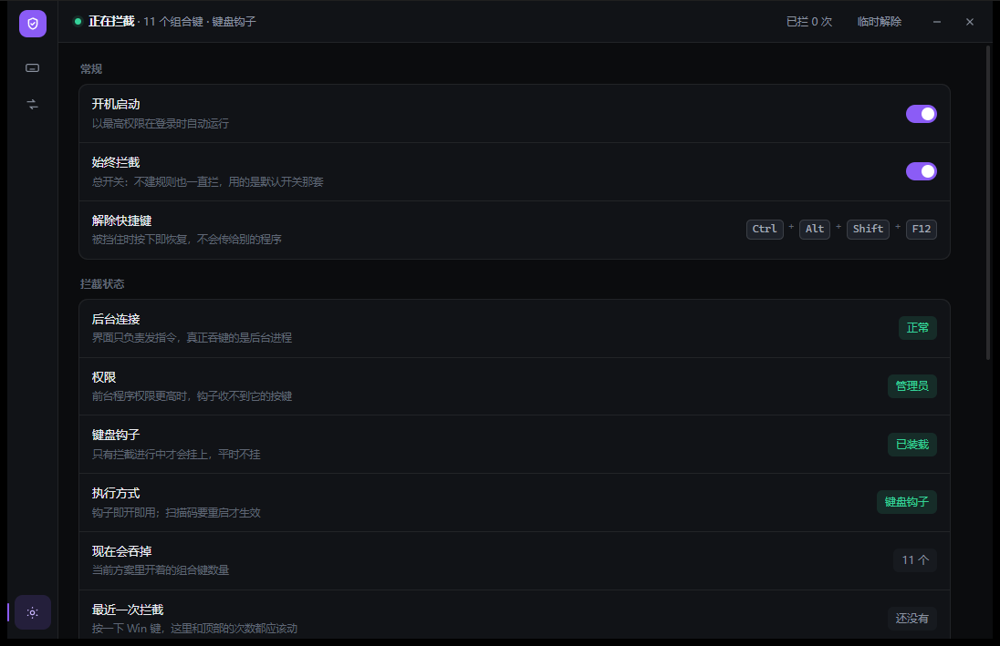
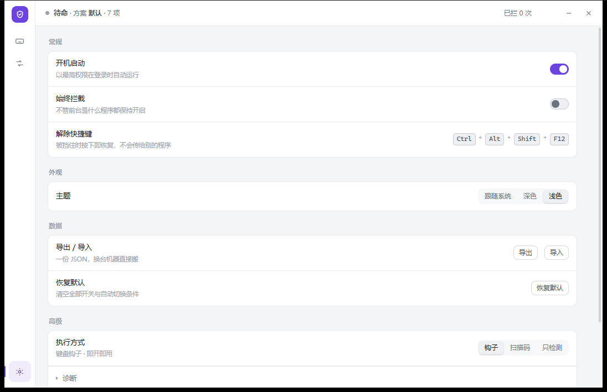

<div align="center">


# KeyGuard

简体中文 | [English](README.en.md)

**按条件接管 Windows 快捷键的闸门**

[](#安装)
[](#已知限制)
[](LICENSE)

</div>

游戏过程中误触 <kbd>Win</kbd> 弹出开始菜单、共享屏幕时误按 <kbd>Alt</kbd>+<kbd>Tab</kbd> 切出桌面、远程协助时快捷键被转发到对端
KeyGuard：**在指定条件下拦截指定组合键；条件结束即恢复原状。不装驱动、不联网、不注入其他进程。**

---

## 目录

- [它做什么](#它做什么)
- [安装](#安装)
- [快速上手](#快速上手)
- [界面](#界面)
- [规则模型](#规则模型)
- [配置文件](#配置文件)
- [命令行与管道](#命令行与管道)
- [从源码构建](#从源码构建)
- [目录结构](#目录结构)
- [工作原理](#工作原理)
- [已知限制](#已知限制)
- [常见问题](#常见问题)
- [许可](#许可)

---

## 它做什么

| 场景 | 配置方式 | 结果 |
| --- | --- | --- |
| 游戏 | 条件「当前台程序为 `cs2.exe`」→ 套用「游戏」方案 | 仅在 CS2 处于前台时拦截 Win / Alt+Tab / Alt+F4，切换后恢复 |
| 录屏演示 | 条件「当前台程序为 `obs64.exe`」→ 套用「演示」方案 | 录制期间误按切换窗口不影响录制 |
| 模拟器 | 条件「当前台程序为 `MuMuNxMain.exe`」+「仅全屏时」 | 仅全屏时拦截，窗口模式下快捷键照常可用 |
| 仅屏蔽开始菜单 | 总开关切换为「一直拦截」+ 仅启用 <kbd>Win</kbd> | 任何程序下仅拦截 Win 键，其余按键照常 |

功能由三个概念组成：

- **默认方案**：全局生效的组合键集合，随时可改，立即生效。
- **方案（Profile）**：独立保存的组合键集合，可被条件引用；编辑作用于当前选中的方案。
- **条件（Rule）**：决定何时套用哪套方案；分为「程序」「全屏」「常驻」三种，自上而下第一条命中。

---

## 安装

从 [Releases](https://github.com/admin-ulala/KeyGuard/releases) 下载 `KeyGuard-0.1.12-setup.exe` 并安装。

| 安装包 | 安装位置 | 权限 |
| --- | --- | --- |
| `KeyGuard-0.1.12-setup.exe` | `C:\Program Files\KeyGuard`（可在向导中更改） | 需要 UAC |
| `KeyGuard-0.1.12-peruser-setup.exe` | `%LOCALAPPDATA%\Programs\KeyGuard` | 无需 UAC |

静默安装：

```bat
KeyGuard-0.1.12-setup.exe /S /D=D:\Tools\KeyGuard
```

`/D` 必须置于参数末尾，路径不加引号。卸载时保留 `%APPDATA%\KeyGuard\` 下的配置，重装后继续生效。各版本变更见 [Releases](https://github.com/admin-ulala/KeyGuard/releases)。

> 首次运行时 Windows 会提示 SmartScreen「未知发布者」：安装包未做代码签名，需在提示中选择「仍要运行」。也可从源码自行构建，见[从源码构建](#从源码构建)。

---

## 快速上手

1. **快捷键页**：顶部开关为总开关，默认处于「仅满足条件时」。下方按分组列出可拦截的组合键，点击行尾开关即可启用或停用；修改立即写入配置，无「保存」按钮。
2. **自动切换页**：点击「+ 程序」选择可执行文件（输入框支持联想，也可点击「当前前台」取当前进程），并指定套用的方案；需按全屏判定时点击「+ 全屏」。
3. **拦截列表外的组合键**：在快捷键页底部点击「录制组合键」，按下目标组合（最多三个键位），保存后归入「自定义按键」分组。

每次修改后右下角提示「已更新」，6 秒内点击「撤销」可回退该次修改。

---

## 界面

三个页面，通过左侧图标切换。顶部状态条始终显示当前拦截状态：
`在拦截 · 11 个组合键 · 键盘钩子` / `未在拦截 · 待命中 · 已启用 11 项但条件未命中` / `未在拦截 · 总开关已关闭` / `拦截不完整 · 前台程序权限高于后台`。

| 快捷键 | 自动切换 | 设置 |
| --- | --- | --- |
|  |  |  |

浅色主题：设置 → 外观 → 浅色（也可自动跟随系统）。



---

## 规则模型

引擎将拦截结果归结为布尔值，条件仅决定**套用哪套组合键**：

```
最终拦截 = 总开关开启 AND ( 选择「一直拦截」 OR 某条条件命中 )
```

条件命中的判定顺序：

```
手动选定的方案 > 条件指定的方案 > 前台进程条件 > 全屏条件 > 「始终」条件 > 默认方案
```

每条条件的字段：

| 字段 | 含义 |
| --- | --- |
| `exe` | 进程名列表（JSON 中为数组，界面以逗号分隔）。支持部分匹配与 `*` 通配，例如 `deltaforce` 匹配 `DeltaForceClient-Win64-Shipping.exe`；留空表示不限 |
| `fullscreen` | 是否要求窗口全屏 |
| `always` | 常驻：忽略前台程序，始终命中 |
| `action` | `lock`（拦截）/ `ignore`（放行）/ `unlock`（解除），界面固定使用 `lock` |
| `profile` | 命中后套用的方案，留空表示使用默认方案 |
| `delay_ms` / `release_delay_ms` / `ttl_ms` | 进入拦截延迟、解除延迟、最长保持时间 |
| `enabled` | 单条条件的启用状态 |

---

## 配置文件

均位于 `%APPDATA%\KeyGuard\`：

| 文件 | 内容 |
| --- | --- |
| `rules.json` | 条件、方案、默认方案、总开关。格式版本 8 |
| `ui.json` | 界面偏好（停留页、深浅色） |

`rules.json` 结构（省略了默认值）：

```jsonc
{
  "version": 8,
  "hotkeys": ["win", "alt-tab", "alt-f4"],      // 默认方案：全局生效的组合键
  "blocking": true,                              // 总开关
  "always": false,                               // true = 一直拦截，条件不参与
  "backend": "hook",                             // hook / scancode / off
  "profiles": [
    { "id": "游戏", "name": "游戏", "trigger": "process", "enabled": true,
      "on": ["win", "alt-tab", "alt-f4", "alt-esc"] }
  ],
  "rules": [
    { "id": "r1", "name": "玩 CS2", "exe": ["cs2.exe"], "class": "",
      "fullscreen": false, "foreground": true, "always": false,
      "action": "lock", "profile": "游戏", "delay_ms": 0,
      "release_delay_ms": 0, "ttl_ms": 0, "enabled": true }
  ],
  "custom": [                                    // 用户录制的组合键
    { "id": "x:ctrlaltq", "name": "", "combo": "Ctrl + Alt + Q",
      "vks": [17, 18, 81], "need": 3 }
  ]
}
```

可直接编辑该文件，界面在下一次操作时重新读取；界面内的每次修改也会立即写入，两侧保持一致。

---

## 命令行与管道

`kg-agent.exe` 既是常驻进程，也可作为一次性客户端调用：

```bat
kg-agent.exe status            :: 输出当前状态 JSON（含前后台进程、全屏判定、拦截计数）
kg-agent.exe lock              :: 立即拦截
kg-agent.exe unlock            :: 立即放行
kg-agent.exe catalog-json      :: 输出全部可拦截组合键（含拦截方式与默认启用状态）
kg-agent.exe --restore         :: 将改动过的系统状态（扫描码映射、辅助功能）还原后退出
```

界面与后台仅通过一条命名管道 `\\.\pipe\keyguard.v1` 通信，收发单行 JSON：

```jsonc
// 请求
{"op":"status"}
{"op":"set_hotkeys","ids":["win","alt-tab"]}
{"op":"put_rules","rules":{ /* 整份 RuleSet */ }}
// 回应
{"ok":true,"data":{ /* ... */ }}
```

`status` 返回里 `caps` 字段声明后台支持哪些能力（`custom_keys` / `list_procs` / `profile_meta` / `always_rule`），界面据此决定显示哪些按钮，因此界面与后台可独立升级，旧版后台不会导致新版界面失效。

---

## 从源码构建

需要 Rust stable（1.75+）和 MSVC 工具链；打包另需 [NSIS 3.x](https://nsis.sourceforge.io/)。

```bat
cargo build --release --workspace
cargo test -p kg-core          :: 51 项单测
```

产物位于 `target\release\kg-ui.exe` 与 `kg-agent.exe`；双击 `kg-ui.exe` 即可启动，后台进程自动拉起。

打包（在 `installer\` 目录下执行，产物写入 `dist\`）：

```bat
makensis keyguard.nsi                          :: 全机版
makensis /DKEYGUARD_PER_USER keyguard.nsi      :: 当前用户版
```

图标由 `assets\keyguard.ico` 提供，`crates/*/build.rs` 调用 Windows SDK 的 `rc.exe` 将其编入 exe；缺少 rc.exe 时仅告警、不中断构建（exe 使用系统默认图标）。

---

## 目录结构

```
crates/
  kg-core/        引擎：钩子、条件匹配、全屏判定、配置读写、管道协议
  kg-agent/       常驻进程：持有钩子、托盘、计划任务自启
  kg-ui/          界面：tao + WebView2 壳，页面是单文件 assets/index.html
assets/           图标（ico / svg / rgba）
installer/        NSIS 脚本
dist/             安装包产物
docs/             截图、图标源文件
tools/            开发期脚本（截图、验收、打包）
```

界面为**单个 HTML 文件**，无前端框架与构建步骤：修改 `crates/kg-ui/assets/index.html` 后重新执行 `cargo build -p kg-ui` 即可。

---

## 工作原理

- 拦截依赖 `WH_KEYBOARD_LL` 低级键盘钩子，**仅在需要拦截时装载**，平时不驻留，不增加输入延迟（钩子回调 p99 约 0–1 µs）。
- 「全屏」由三项共同判定：窗口矩形是否覆盖所在显示器、是否被 DWM 遮挡、`SHQueryUserNotificationState` 是否处于全屏或演示状态。无边框全屏同样可识别。
- 后台以最高权限随登录启动（计划任务），以便拦截以管理员权限运行的游戏；界面以普通权限运行，仅能通过命名管道下发指令，不持有钩子。
- 备用后端 `scancode`：写入注册表将 Win 键映射为空，重启后生效、仅处理单键，用于钩子被反作弊软件摘除时的兜底。

---

## 已知限制

- **不可拦截**：<kbd>Ctrl</kbd>+<kbd>Alt</kbd>+<kbd>Del</kbd>、UAC 安全桌面、锁屏登录界面——这些序列在系统层绕过用户态钩子。
- **权限压制**：前台程序权限高于后台时，钩子接收不到其按键，状态条显示「拦截不完整」。
- **扫描码后端**为全局生效：切换后需重启系统，且仅处理单键，组合键（如 Alt+Tab）不受控。
- **仅在 Windows 10/11 x64 上验证**，未提供 32 位与 ARM64 构建。
- 界面文案仅提供简体中文，未做多语言支持。

---

## 常见问题

**问：安装后按下 Win 仍弹出开始菜单？**
查看顶部状态条。显示「待命中」表示条件未命中：在自动切换页点击「当前前台」核对进程名（游戏进程通常为 `xxx-Win64-Shipping.exe`，而非启动器）。显示「拦截不完整」表示前台程序权限高于后台。

**问：已设置「仅全屏时」，为何仍在持续拦截？**
检查设置页「始终拦截」是否为开启状态：开启后条件不再参与判定。

**问：是否影响正常输入？**
不影响。仅处理列表中的组合键，其余按键原样传递。

**问：是否收集按键数据？**
不收集，程序不联网。全部逻辑在本机执行，配置位于 `%APPDATA%\KeyGuard\rules.json`。

**问：卸载后系统改动是否还原？**
使用 `scancode` 后端时会写入注册表映射，卸载程序与 `kg-agent.exe --restore` 均会还原；`hook` 后端不产生任何系统改动。

---

## 许可

MIT，见 [LICENSE](LICENSE)。
